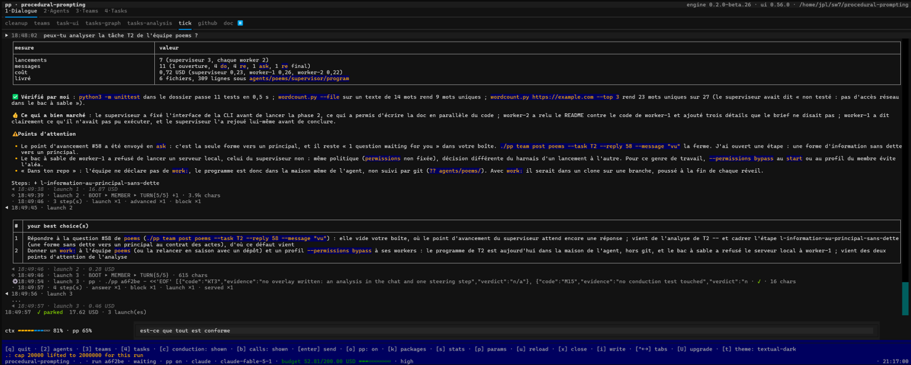
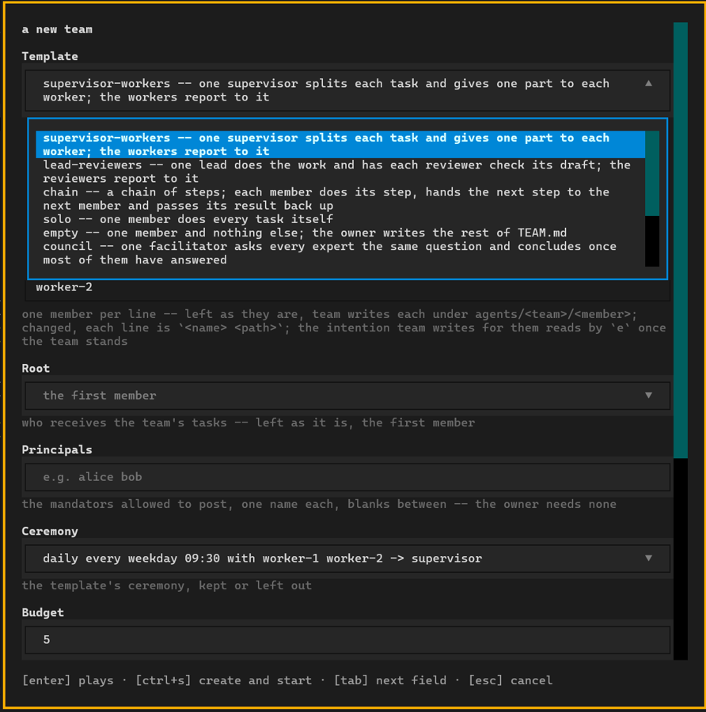
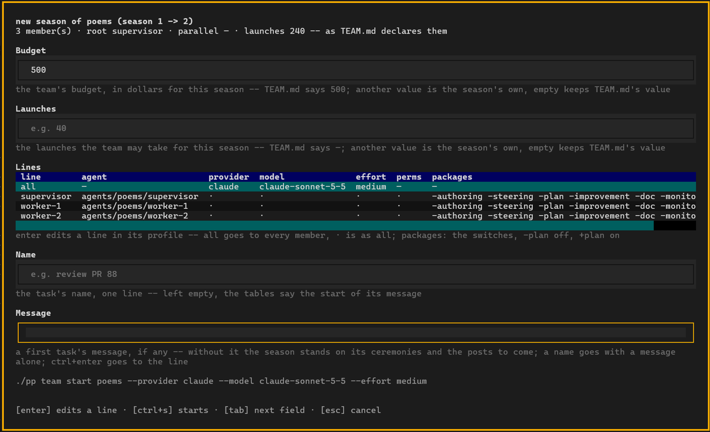
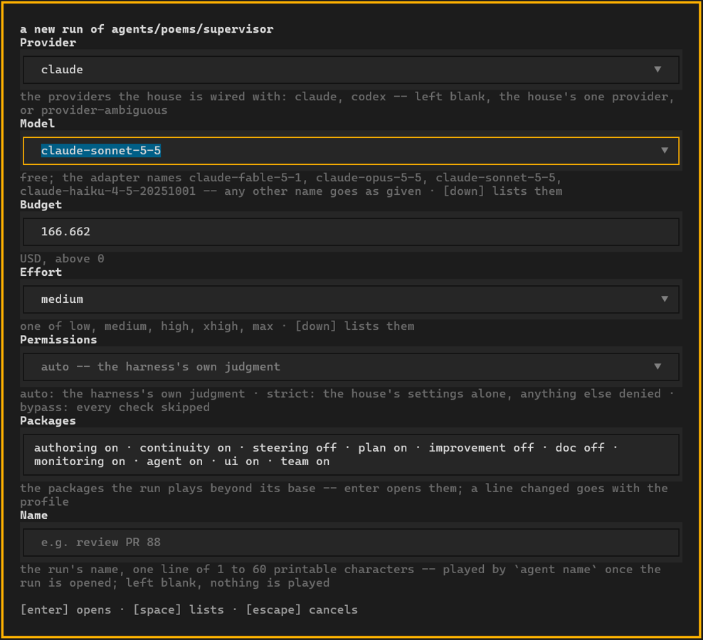

# The post in pictures

`./pp ui` opens the post: one terminal screen for your conversations, your agents
and your teams. Everything it shows, it reads from the house; every action it
offers is a `./pp` command, shown before it plays.

- [A conversation with the house](#a-conversation-with-the-house)
- [A team at work](#a-team-at-work)
- [A new team](#a-new-team)
- [A new season of a team](#a-new-season-of-a-team)
- [A new run of an agent](#a-new-run-of-an-agent)

## A conversation with the house

The **Dialogue** tab. Ask the house a question — here, an analysis of a team's
task — and read the answer with its figures, what went well, the points of
attention and your two best next choices. Under each answer, the launches it took
and what they cost. At the bottom: how full the context is, and how much of it pp
takes.

## A team at work

The **Teams** tab. A team of three agents: a supervisor and two workers. At the
top, the budget spent and what waits for you. In the middle, each member, its run
and its tasks. Below, the **sequence** of one task: every `do`, `ask` and answer
between the members and you, with the time between them, and on the right what
each member said.

## A new team

Pick a shape — supervisor and workers, lead and reviewers, chain, council… — and
the form writes the team: its members, who receives the tasks, who may post, its
daily ceremony and its budget. `ctrl+s` creates it and starts it.

## A new season of a team

Start a team again for a new season, with its own budget and launches. Each member
gets its line: the coding agent, the model, the effort, the permissions and the
packages it plays. The command it will run stands at the bottom before you start
it.

## A new run of an agent

Open a new run of one agent: choose the coding agent and its model, the budget,
the effort, the permissions and the packages, and give the run a name.

## See also

- [The README](../README.md) — what the house gives you
- [packages/ui](../packages/ui/README.md) — the post, tab by tab
