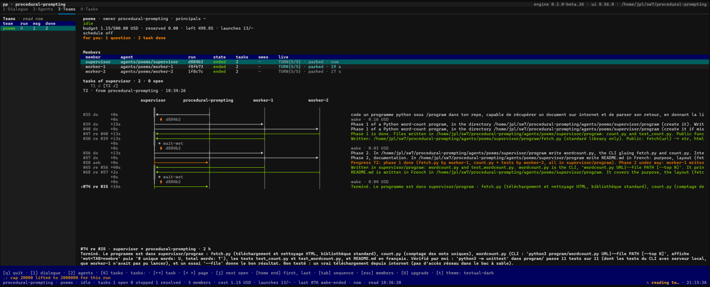

More pictures: [the post in pictures](../../docs/screenshots.md).

# ui

> **Experimental package.** Its procedures, records and user-facing behavior
> may change between versions.
>
> **Current version:** `0.56.2`

`ui` is a package for [Procedural Prompting](../../README.md). It gives a house -- a
workspace with the [`agent`](../agent/README.md) and [`team`](../team/README.md)
packages -- a **post**: a terminal screen, opened by `./pp ui`, to talk with its
agents, browse their runs and follow its teams.

The post shows what the commands of `pp` say and plays every action through them. It
conducts nothing and reads no file of the instance; the only thing it writes is its
memory of the conversations left open.

## Role

The commands of `agent` and `team` are complete, but following several conversations
and several teams by typing commands is slow. The post puts them on one screen: each
conversation in its own tab, every agent and run in a table, every team and task with
its state, and every action shown as the exact command it will play before it plays.

It answers four questions:

- What is each agent saying now, and which message produced it?
- Which runs does each agent have, what did they cost, and how full is their context?
- What is each team doing, and what does it wait for from me?
- Which command will this key play?

## Features

### Four tabs

| tab | what it holds |
|---|---|
| `1·Dialogue` | one tab per conversation; each thing the agent said, whole, rendered as markdown, a dim line per launch and per tool call, the context gauge, a stop key |
| `2·Agents` | the agents of the house, then the runs of each in an overlay: resume, name, statistics, weight, purge |
| `3·Teams` | the teams, each shown by the `name` of its `TEAM.md` (its directory when it has none): their state, budget, members and ceremonies; under a member, its tasks and the sequence of the one chosen; start a season, pause, raise the budget, read the declaration, delete a team (`D`) |
| `4·Tasks` | the tasks of every team, the newest first, each with the moment it was born; `recent` by default -- the open tasks and those ended within the last 24 hours; the sequence of a task -- who sent what to whom, live -- or the result of a finished one, whole; post, reply, stop, take back |

### Conversations

`./pp ui dev` opens the post with a conversation with the agent `dev`; `./pp ui .`
talks with the house itself. Each conversation is one `agent chat` held under the
post, one run from a message to the next. Its parameters -- provider, model, budget
cap, effort, permissions, packages -- are set in an overlay before it opens. Switching
tabs reloads nothing: a conversation in the background goes on, and what you have not
read is counted on its title. `u` reloads the tab you are on: its whole past -- every
message, launch, tool call and answer of its run -- shown at once. During a turn, `u`
waits: the remedy line says so. Your messages stand slightly to the right on a light
veil of the theme's colour, so that your voice and the agent's are told apart at a glance.
Left of the message line stand two zones of fixed width: the context gauge -- the part of the
model's window the run fills, as the provider measured it at its last call, and moving with each
call during a turn; a figure the house only estimates is marked `~` --, then the alert,
which says `⏸ pp OFF` when the conduction is suspended; the stop button keeps its place right
of the line, hidden at rest. On the status row at the bottom, the turn under way or the faces
being read show in a zone of their own on the right, before the clock: nothing on the screen
shifts when they come and go. A conversation given back at the post's opening shows its run's
model, budget, packages and context at once, before any message wakes it.
The header says the engine's version and the post's.

### Gestures shown before they play

Every action of the post is a command of `pp` played in a child process. An overlay
shows the fields it needs and the command it will play, word for word; a refusal is
shown as the command said it. What destroys -- stopping every task of a team, forgetting
a member's run, deleting a team -- plays only once you type the name of what it destroys.
`D` on the Teams tab first shows what `team delete` would remove: the team's folder and
journal, its timer and calendar line, the runs it opened, and the agents it keeps.

A task you post from the Tasks tab is followed: once its team says it, the cursor is on it,
and the filter turns to `recent` if the one in place would hide it; the cursor stays on it
when it ends. Under the list, a task shows its SEQUENCE: one column per participant -- you,
then each member as it joins --, one arrow per message from its sender to its receiver, the
time since the row before it beside each (`+4m30`), each
wake-up of a member with its cost, and in blue under each member's name what it plays now;
the sequence grows as the team works. `tab` goes into it: the arrows move a cursor, `enter`
opens a message whole, `w` hides the wake-ups. A finished task shows its result instead,
rendered as markdown and whole -- `tab` goes into it to scroll it --, and `v` switches between
its result and its sequence.

On the Teams tab, under the member chosen, a band shows its tasks -- as many as the width
holds, the oldest on the left, those out of sight counted on each side; `<` `>` turn a page,
`j` goes to the next open one -- and under it the sequence of the task chosen, centred on the
member: its column first, then the members it exchanged with alone. The band and the sequence stay in
place while the team works; coming back to a member finds the task you left it on.

### Upgrade and doctor from the post

`U` opens the gesture that upgrades or repairs the machine: `upgrade` or `doctor`, the
command it plays shown (`./pp upgrade`), then the post's opening (`./pp ui`). Confirmed, the
post closes its conversations, the console plays the verb, and the post opens again on its
tabs, its status line saying what the verb answered. A post opened again this way asks no
second one: quit it and open `./pp ui` again for that.

### The memory

`./pp ui` with no agent named opens at once on the conversations left open last time.
Each tab shows its run's past messages and answers as history, read when you first show
the tab; its `agent chat` starts
only when you send a message there (or change its parameters, its conduction or its
packages). `u` shows the tab's whole past. The post keeps that memory, and the theme you
chose, in the data the engine keeps for each package of the instance.

While the post reads something -- the agents, a tab's past --, a spinner turns at the head
of the status line and says what is read. A command that does not answer within 30 seconds
is named on the remedy line (`verb-timeout`): the post never shows a half-read list as
complete.

### A pane as text

`./pp ui --render <pane> --size WxH` prints a pane (`frame`, `dialogue`, `agents`,
`teams`, `tasks`) as text and exits, without a terminal; `--press <keys>` renders it
after a sequence of keys. Without a terminal and without `--render`, `./pp ui`
refuses in one line.

## Installation

`ui` requires the `agent` and `team` packages and the `kit`; the installer pulls them
automatically. It needs [`uv`](https://docs.astral.sh/uv/) on the `PATH`: the post's
script declares its own dependency, [Textual](https://textual.textualize.io/), and
`uv` resolves it on the first opening. The engine itself never needs Textual.

For a new workspace:

```sh
uv run pp/engine/pp.py -install <workspace> ui -<provider>
```

For an existing pp instance, from the workspace root:

```sh
./pp add ui
```

## Quick start

Open the post on a new agent and talk with it:

```sh
./pp agent add agents/dev
./pp ui agents/dev
```

Type a message and press `enter`; `2`, `3` and `4` switch to the other tabs; `t`
chooses a theme; `q` closes the post. Open it again later with `./pp ui`: your
conversations come back.

Pass flags to every conversation the post opens after `--`:

```sh
./pp ui agents/dev -- --permissions strict
```

## Reference

The full behavior of the post, tab by tab: what each tab reads, which verb each key
plays, and what each line and column means.

- [The post of a house](#the-post-of-a-house)
  - [What the post is](#what-the-post-is)
  - [The Dialogue tab](#the-dialogue-tab)
  - [The Agents tab](#the-agents-tab)
  - [The Teams and Tasks tabs](#the-teams-and-tasks-tabs)
  - [Resumed runs, themes and the memory](#resumed-runs-themes-and-the-memory)

### The post of a house

#### What the post is

A house that pins the `ui` package has a post. `./pp ui` opens a terminal screen on
the house's own terminal; it is a command played at the terminal, like the other
commands of the [console](../../docs/reference/console.md).

The post is a main, not an engine. It renders what the verbs of `pp` say and delegates
every gesture to them. It conducts nothing, writes no record and reads no file of the
instance.

Textual is pinned in the skill's own script (`textual==8.2.8`). uv resolves it when the
script re-executes itself; the engine never imports it.

#### Rendering without a terminal

| command | what it does |
|---|---|
| `./pp ui --render <pane> --size WxH [--press <keys>]` | prints a pane as text and exits; no terminal needed; the keys are pressed first |
| `./pp ui --render <pane> --regions` | says where the menu, the folded line and each band of a pane stand -- what the bench measures |
| `./pp ui` without a terminal | refuses `tty-missing` in one line |

The sections above this Reference give the frame, the tabs, the keys and the least size.

#### The order of the tabs

The tabs come in the order Dialogue · Agents · Teams · Tasks. `U` shows at the foot of
every tab.

A reading of the Teams, Tasks or Agents tab that raises says so on the remedy line, and
the post stands.

#### The Dialogue tab

##### Opening conversations

The Dialogue tab holds the conversations open, one tab each. Each tab holds its own
`agent chat --json` on the post's loop.

`./pp ui ag1 ag2 [--run <key>]` opens one conversation per agent named, before the post
draws. A refusal of the verb is relayed in one line, exit 2.

With no agent named, the conversations the memory kept come back at once, each one
DORMANT. A dormant tab has no `agent chat` until a message, `p`, `o` or `k` speaks to it.
Its run's exchanges are read in the background and shown as history.

`u` reads the active tab's kept flow again, else its exchanges, and mounts it whole in
one mount. These are the same blocks as the live ones, laid out once whatever their
length. `u` is refused while a turn runs.

##### One run, one tab

- Taking up a run that a live tab holds activates that tab and launches nothing.
- A run whose tab ended is taken up in place, its transcript kept.
- A tab whose flow ended stays, with the refusal in its transcript; `x` alone closes it.
- Closing a conversation ends the verb's whole process group, `pp-agent` and its wake
  lock with it.

##### The transcript of a turn

The transcript reads a turn in the order the flow said it:

1. the principal's message, as markdown;
2. per launch, ONE line of the conduction: the block it serves, as the `conduction` event
   names it (`blocks`, read from the run's trace, never from pp's text);
3. what the agent did meanwhile (see the table below);
4. ONE line of its steps, counted by kind;
5. ONE line of what the agent answered;
6. then the answer of the turn, as markdown, and the verdict.

| line | what it shows |
|---|---|
| `⚙` | ONE line per call of a tool; `pp` for a call of the agent's console; updated by its result -- `✓`, or `✗` and the line red |
| `∴` | ONE line of the launch's thought |
| `◀` | the launch's words, the last ones not twice |

##### Live and stale lines

A line whose overlay has content to show is LIVE. It opens WHOLE in an overlay, with
`enter` or a click: for a call, its input then its result. The content is folded to the
width and built when the overlay opens.

A line with nothing to show is STALE: a thought of a count alone, words or a result left
blank. It takes the theme's disabled text, in italic, with no focus, and nothing opens.

A line is judged again by its event's fields at each update, so a thought turns live when
its text comes.

An overlay renders the agent's answer and words as markdown, and any other content as the
text it is. An event's overlay titles itself on one line with the kind of the line, read
from the flow's `kind`.

##### Overlays and selection

- Every overlay keeps its keys in sight; its body scrolls.
- Every block is selectable with the mouse and copied by `ctrl+c`.
- `U+FE0F` is taken out of what the post renders, so that tables stay aligned.
- The footer lays its keys on as many lines as the width asks, a line breaking only
  between two keys.

##### The message line and a running turn

The message line holds several lines: one row at rest, growing to 8.

While a turn runs, a spinner turns on the tab's title and on the status. It is bold, in
the theme's accent, and followed by how long the turn has run. The message line holds
what is typed until the turn ends.

| key | effect |
|---|---|
| `enter` | sends the whole text |
| `shift+enter`, `alt+enter`, `ctrl+j` | go to the next line |
| `■ stop` | the button beside the message line, shown while a turn runs: stops the turn |
| `ctrl+g` | stops the turn |
| `escape` | leaves the message line; it never stops a turn |

##### What a tab knows before any message

A tab knows its run from its opening, before any message. The flow's `ready` gives the
provider, the policy, the packages, the cap and whether the run is conducted. These are
read from its fields; no line of the transcript is written for it. So the status line,
`k` and `p` hold before anything was sent.

Above the transcript, a bubble says the principal's message of the turn at the top of the
view. It is rewritten only when that turn changes.

Beside the message line, a gauge says the run's context as `context` of
`agent stats --json` says it: `ctx ▰▰▱▱▱▱▱▱▱▱ 17% · pp 33%`, pp's share in the theme's
accent, or `ctx —` when there is no figure. It is read after each verdict and when a run
is taken up.

`pp off` shows in the tab itself: a banner just above a bordered message line.

##### Keys on a conversation

| key | effect |
|---|---|
| `p` | opens the parameters of the run and sends the changed ones as a `set`; its last field is the run's NAME, played by `agent name` -- at once, or at `opened` for a run that opens |
| `o` | suspends the run's conduction or brings it back (`conduct` to the verb) |
| `k` | opens, in an overlay that edits them, the packages the run plays beyond its base |
| `s` | gives the conversation's statistics |
| `u` | reads the tab's past again (see above) |
| `c` | hides the lines of conduction, of steps, of calls and of thought, and shows them again |
| `x` | closes a tab whose flow ended |

**Budget.** Once the flow says the run's budget (`budget {cap, spent, left}`), the status
says it: `budget 0.42/2.00 USD` and a bar of ten cells. The bar is green, yellow past
80 %, bold red at the cap.

**Conduction off.** After `o`, the tab shows `⏸` and the status `pp off`. Under `pp off`
a message is a bare exchange, and the verdict is `unconducted`.

**Packages (`k`).** In the overlay, `space` toggles a line and sends nothing; `enter`
sends one `package` per line changed; `escape` sends nothing.

A switch the verb holds waits until it plays (`pending`). Meanwhile it is seen as `⧗` on
the tab, `packages: … …` on the status and `… pending` at `k`. The state shown is always
the one the flow said.

#### The Agents tab

##### What it reads

The Agents tab is the table of the agents of the house. It is read from
`agent list --json` and `agent status --json` at the start, on `u` and after every
verdict, never polled. The statuses are read four at a time, each line filled as its face
arrives.

The header says the engine's version and the post's, read from `./pp version -json`.
The principal's messages stand four columns to the right on `$primary 12%`.

A verb past its bound (30 s, `PP_UI_TIMEOUT`) is said `verb-timeout` on the remedy line.
Its face is never shown, and the line of the last reading is kept.

A tab the memory gives back reads its past when it is first shown. While a face is read,
the spinner turns at the head of the status: `reading <verb> ×<n>`.

##### The house itself

The HOUSE itself heads the table. `.` names the house's own instance for every verb of
`agent`.

- `./pp ui .` and `n` on its line open a run NEW on it, with its threads, its plans and
  its continuity.
- Its face counts only its runs of the post; the conversations of its host (VSCode) stay
  out (`run-unconducted` on one of them).
- `--work` on it refuses `work-on-house`.

##### The runs of an agent

On an agent, `enter` opens the overlay of its runs. Each run and each agent says its
`weight`. The table of the runs says each run's `pp` and `ctx` (`~xx %`, read from
`context` of `agent status --json`).

| key | effect |
|---|---|
| `enter` | resumes the run in a tab of the dialogue, its kept flow replayed as it was lived (`agent flow --json`; `agent exchanges --json` for a run that keeps no flow) |
| `P` | purges the run under the cursor, SHOWN first |
| `B` | purges the agent's runs before a date, SHOWN first |
| `s` | stacks its statistics (`agent stats --json`): the run, pp as the engine counts it, and the context approached from the run's flow -- the same overlay as `s` on a conversation's tab |

A run is named in its parameters (`agent name`). The name is what a user types: one line
of 1 to 60 printable characters, accents kept.

**Purge.** `agent purge` is first played without `--yes`, and says what it would remove.
Its `--yes` command plays only once the run's key -- or the date -- is typed as it is.
After `workdir-unpushed`, `--force` is offered under a second typing. Every refusal of
the verb goes on the remedy line.

##### A new run

`n` asks for a new run. The parameters of a run -- provider, model, budget, effort --
live in ONE overlay. They are prefilled with what the agent last played (`last` of
`agent status --json`, and the models and spells of `agent providers --json`).

The permission regime follows: `auto` left blank, `strict`, or `bypass` (warned).

Then comes the line of its PACKAGES, read from `packages` of `agent status --json` and
toggled in their overlay. That overlay is the PROFILE of a launch, `ProfileScreen`: the
one form wherever the post launches something. A package the caller holds required is
greyed and never toggles.

`enter` opens the conversation with those flags, after the ones of `--`: one
`--package <name>=on|off` per package changed among them.

`p` sends a package changed on its line, as `k` does. On a run, `p` changes the regime
too, as a `set` like the model's (`policy-unsupported` for a provider that does not spell
it).

##### Adding an agent, and the flags of `--`

`a` plays `agent add <path>`, its exact command shown first.

The post types nothing outside a conversation's message line. What it asks, it asks in an
overlay -- the cockpit's form -- and overlays stack.

What follows `--` goes to every `agent chat` the post opens (`--harness`,
`--permissions`, `--launches`).

#### The Teams and Tasks tabs

##### Layout

The Teams and Tasks tabs show the teams of the house as `team status --json` says them,
from the first time each is shown. They pilot them by the verbs of `team` alone.

Each tab is a MENU on the left and a CENTRE of horizontal bands -- never two parts side by
side -- and the rest in overlays.

Under 70 columns the menu folds into one line, which `[` `]` (and `{` `}`) change. The
layout alone does it; no code reacts to a resize.

The tabs compute no state of a team and hide no key because of one: `team` judges.

##### The Teams tab: who the teams are

The **menu** lists the teams declared. Each name takes the look of its `state`:

- `working`;
- `waiting`, bold when the owner alone lifts what holds it;
- `paused`, with `⏸`;
- `idle`;
- `never`.

Beside each name: the wake-ups under way, the questions to the owner as the inbox counts
them, the tasks done not seen, and `-` for a team never started.

The **head** of the team chosen gives:

- its owner and mandators;
- its state (`waiting · owner, budget`, `paused since … by …`);
- its budget as the face says it (`budget 1.84/2.00 USD · reserved 0.10 · left 0.06`);
- its wake-ups against their bound, and its net;
- what waits for the owner, counted on one line.

The **members** give the agent, the run, how it stands, the tasks, and `live`. They also
give the debts the member still owes (`owes`, bold yellow once one was reminded). A
member the face says suspected is in bold red with `try HH:MM`.

A member's `live` is its last step on its team's watch, or `since` while the face says it
is running.

##### The watch of a team

ONE `team watch <name> --json` follows the team chosen; its objects are read on its
stderr. Every object but `quiet` reads the team again.

The post holds at most one watch per team, shared by the two tabs, a thread and a read
tab -- never one per task.

- Choosing another team leaves the first one's watch, which ends when nothing else
  follows it.
- Leaving the post ends every watch whole.

##### The Tasks tab: what the teams do

Two filters, each with its count:

| filter | values |
|---|---|
| `SHOW` | `running` first, `for you` (a question to the owner or an end not seen, as the face's `waiting` lists them), `stopped`, `resolved`, `all` |
| `TEAM` | the team |

The list holds the tasks every started team keeps, read by one `team status <name> --json`
per team. Its columns:

| column | content |
|---|---|
| id | the task's id |
| name | the name, else the start of the task's text cut at 30 characters (`text`) |
| holders | the holders |
| progress | counted on the face's `dos` |
| cost | `cost` |
| age | the age of the last event (`last`; `3 min`) |
| spinner | before the name of a task a wake-up plays (`running`); the tab's title counts them, `4·Tasks ⠹ 2` |

Below the list stands the task under the cursor, whole: its name, its whole text, its cost.

##### The last action of a task

Then comes its LAST ACTION: ONE `live:` line per member.

- The line gives the last step a wake-up of that member said on the task. It is tied to
  its member and its task by the step's own `agent` and `task`.
- It then gives the last call of a tool of that wake-up, read from its kept flow
  (`agent flow <path> <run> --exchange <index> --json`, one reading per member at a time).
- It turns dim once that wake-up ended.
- A member the face says running with no step seen shows `launched` (`launched 12 s ago`).
- After the run of a wake-up the face says is a reminder, it shows `relance owed`.

A task at rest says its `last` event.

##### Freshness

Every freshness of the two tabs is an AGE against the post's one clock: the hour of its
reading on the status line. Ages read `12 s`, `3 min`, `2 h`, `3 d`; the menus say
`read 12 s ago`.

The thread of a task and the journal keep the hour of each event. They say the debt in
the face's words: `re #45`, `notice about lead`, `by tick · preempted`, `(was done)`.

##### The thread of a task

`enter` opens the task's THREAD in an overlay:

- its history, read by `team log --json --task`;
- then what the team's watch says that names the task;
- the history read again at the overlay's first object and at an end of a wake-up -- an
  `id` shown once, nothing lost;
- a `live:` line with the last step of a wake-up of the task.

##### How a gesture plays

Each gesture's command is made from what is chosen, and SHOWN word for word before it
plays. Its refusal goes on the remedy line as the verb said it. The team or the tasks are
read again after it.

A gesture that asks more than a yes is written in an overlay: its fields, each with its
help, and the command they make under them. `enter` from any field plays it. A field left
as it opened composes no flag.

Each gesture on a task is titled by the task's id and name: `T3 · review PR 88`.

##### Keys on the Tasks tab

| key | gesture |
|---|---|
| `m` | writes on the task under the cursor: `to`, `as`, `reply to` read from `team status --json` (the owner writes no `--as`), then the text |
| `s` | stops the task |
| `r` | resumes it (a message, `as`) |
| `k` | kills its wake-ups once its id is typed |
| `v` | shows its result (`team result`) |
| `n` | posts a new task: its team, its name (`--name`), `to`, `as`, its message |
| `l` | shows the journal |
| `enter` | opens the thread |

##### Keys on the Teams tab

| key | gesture |
|---|---|
| `N` | gives birth to a team from a template (see below) |
| `n` | posts a new task, as on the Tasks tab |
| `T` | ticks |
| `S` | opens the SEASON of the team (see below) |
| `B` | raises its budget (`team budget`, prefilled from the face; a field changed alone is played) |
| `b` | shows the owner's inbox (`team inbox --json`): `enter` on a question replies on its task, `x` marks it seen |
| `e` | shows its declaration (`team declaration --json`), read only |
| `X` | stops all tasks once the team's name is typed; its overlay says what it stops, as the face counts it |
| `P` | pauses the team, or resumes it when the face says it is paused (`team pause`, `team resume <name>`, `--as`) |
| `l` | the journal |
| `c` | opens the ceremonies |

On a member:

| key | gesture |
|---|---|
| `R` | resets its run once its name is typed |
| `d` | shows it whole |
| `a` | its responses (`team responses --json --agent`) |
| `enter`, `i` | reads its run in a tab of the dialogue (see below) |

##### Birth of a team (`N`)

The form reads `team templates --json` and plays `team new` as it shows it. A field left
as it opened composes no flag, and the post writes no file. `ctrl+s` then starts the team
just born.

##### The season (`S`)

`S` opens `SeasonScreen`: an `all` line and one line per member of `declared`
(`team declaration --json`). Each line is edited in its `ProfileScreen`.

- A member's field left empty takes `all`'s.
- A package the face says `required` is greyed.
- A new season opens on the face's `launch` and `members[].launch`; a first one opens on
  the agents' `last`.

The command composes:

- what `all` carries (`team start` keeps only what it is given);
- each member's changes and switches;
- `--budget`/`--budget-launches` where they differ from `TEAM.md`'s, never a
  `--max-budget-usd`;
- the message owed when no task is open.

A declaration that `start` would refuse opens nothing.

##### The run of a member, read only

The run of a MEMBER is read in a tab of the dialogue. It opens with `enter` or `i` on a
member, or `enter` on a run that the overlay of an agent's runs marks `<team>/<member>`
(read from `team status <name> --json`, the member's `path` and `run`).

The tab opens with a `◉ read only` banner and no message line: no `agent chat` holds the
run the team wakes.

Its kept flow is replayed as lived turns (`agent flow --json`: what pp served, the calls,
the thought, the answer). Then come its wake-ups, live from its team's watch. The tab
keeps the objects of that member AND that run, and reads again the exchange a step names.

A run without a kept flow (before agent 0.22.0) is replayed from its exchanges.

##### The ceremonies (`c`)

The CEREMONIES open over the Teams tab with `c`.

- Their table says the progress of each last ring (`1/3 any 2`, counted on the face's
  `progress`).
- The detail gives its chain (`after`, `then`), the participants still waited for, and
  the wait the task of its last ring carries, as its `waits` say it.
- `g` rings the ceremony under the cursor at hand (`team ring <team> <ceremony> [--as]`).
  The command is shown under the table; `ceremony-open` goes on the remedy line.
- `enter` leads to the task of its last ring on the Tasks tab.

##### `--harness` and team starts

A `--harness <command>` given after `--` to `./pp ui` rides `team start` when `S` starts a
team. The `--provider <name>` goes beside it: the grammar its output is read in, in place
of the overlay's provider. Both come before any `--member` of a season. No other flag of
`--` rides `team start`.

##### Proof on the real verbs

The tabs are proven on the REAL verbs of `team` too (`ui-real-team-*`). A team of the bench
is woken by `team`'s own witness harness, never a provider. The scenarios cover:

- a team born from a template by `N`, then started;
- a named task followed in Tasks to its thread;
- the budget raised by `B`;
- the inbox read and seen by `b`;
- the declaration and its gap by `e`;
- a reply, a stop and a resume;
- a ring at hand.

#### Resumed runs, themes and the memory

A run resumed -- from the Agents tab or from the memory -- keeps what it was:
`agent chat --run` takes the provider of its session and its last policy for what the
call does not name.

`t` opens the list of Textual's themes, light then dark, the current one marked. The one
under the cursor shows at once; `enter` keeps it in the memory; `escape` brings back the
one of before.

The post reads the faces of `agent` and plays its verbs. The one thing it writes is its
MEMORY of the conversations open: the agent and the run of each tab, in the space `ui` of
the instance's `metadata.json`, through the engine's face (`metadata.update`).
`./pp ui` with no agent named opens them again, each with its history.

## See also

- [agent](../agent/README.md) -- the agents, runs and `agent chat` the post drives.
- [team](../team/README.md) -- the teams, tasks and ceremonies of the Teams and Tasks tabs.
- [The operator's console](../../docs/reference/console.md) -- the verbs and package commands `./pp ui` is one of.
- [The agent face](../../docs/reference/agent-face.md) -- the loop and commands of a conducted agent.
