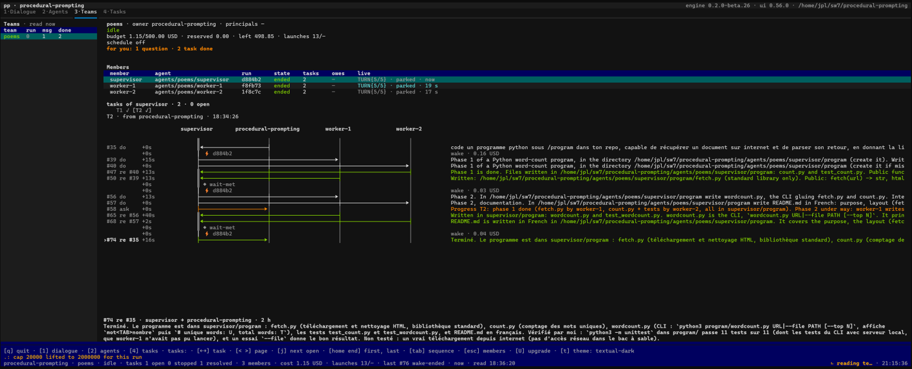

More pictures: [the post in pictures](../../docs/screenshots.md).

# ui

> **Experimental package.** Its procedures, records and user-facing behavior
> may change between versions.
>
> **Current version:** `1.11.4`

`ui` is a package for [Procedural Prompting](../../README.md). It gives a house -- a
workspace with the [`agent`](../agent/README.md) and [`team`](../team/README.md)
packages -- a **post**: a terminal screen, opened by `./pp ui`, to talk with its
agents, browse their runs and follow its teams.

The post shows what the commands of `pp` say and plays every action through them. It
conducts nothing and reads no file of the instance; the only thing it writes is its
memory of the conversations left open.

## Role

The commands of `agent` and `team` are complete, but following several conversations
and several teams by typing commands is slow. The post puts them on one screen: each
conversation in its own tab, every agent and run in a table, every team and task with
its state, and every action asked in a form before it plays.

It answers four questions:

- What is each agent saying now, and which message produced it?
- Which runs does each agent have, what did they cost, and how full is their context?
- What is each team doing, and what does it wait for from me?
- Which command will this key play?

## Features

### Four tabs

| tab | what it holds |
|---|---|
| `1·Dialogue` | one tab per conversation; each thing the agent said, whole, rendered as markdown, a dim line per launch and per tool call, the context gauge, a stop key |
| `2·Agents` | the agents of the house, then the runs of each in an overlay: resume, name, statistics, weight, purge |
| `3·Teams` | the teams, each shown by the `name` of its `TEAM.md` (its directory when it has none): their state, budget, members and ceremonies; under a member, its tasks and the sequence of the one chosen; start a season, pause, raise the budget, read the declaration, delete a team (`D`) |
| `4·Tasks` | the tasks of every team, the newest first, each with the moment it was born; `recent` by default -- the open tasks and those ended within the last 24 hours; the sequence of a task -- who sent what to whom, live -- or the result of a finished one, whole; post, reply, stop, take back |

Every zone of a tab is framed and labelled -- `Members`, `Sequence`, `Tasks`, `Agents · read
12 s ago`, a conversation's `<agent> · run <key>`. From 70 columns and 30 rows the frame is
round, its label in its top edge; smaller, one thin line above the zone carries its label,
no row is spent on a title, and one thin `│` parts the menu of Teams or Tasks from its centre
(a frame's side takes its place in the round frame).

### Conversations

`./pp ui dev` opens the post with a conversation with the agent `dev`; `./pp ui .`
talks with the house itself. Each conversation is one `agent chat` held under the
post, one run from a message to the next. Its parameters -- provider, model, budget
cap, effort, permissions, packages -- are set in an overlay before it opens. Switching
tabs reloads nothing: a conversation in the background goes on, and what you have not
read is counted on its title. `u` reloads the tab you are on: its whole past -- every
message, launch, tool call and answer of its run -- shown at once. During a turn, `u`
waits: the remedy line says so. Your messages stand slightly to the right on a light
veil of the theme's colour, so that your voice and the agent's are told apart at a glance.
Left of the message line stand two zones of fixed width: the context gauge -- the part of the
model's window the run fills, as the provider measured it at its last call, and moving with each
call during a turn; a figure the house only estimates is marked `~` --, then the alert,
which says `⏸ pp OFF` when the conduction is suspended; the stop button keeps its place right
of the line, hidden at rest. On the status row at the bottom, the turn under way or the faces
being read show in a zone of their own on the right, before the clock: nothing on the screen
shifts when they come and go. A conversation given back at the post's opening shows its run's
model, budget, packages and context at once, before any message wakes it.
The header says the engine's version and the post's.

### Gestures asked before they play

Every action of the post is a command of `pp` played in a child process. An overlay
asks the fields it needs; the post never shows the command itself. Once it played, the
status line says what it did in words (`stopped T3 of core-review`); a refusal is
shown as the command said it. What destroys -- stopping every task of a team, forgetting
a member's run, deleting a team -- plays only once you type the name of what it destroys.
`D` on the Teams tab first shows what `team delete` would remove: the team's folder and
journal, its timer and calendar line, the runs it opened; the agents the team alone declares
are listed as checks, none checked -- `space` checks one and the command gains its
`--agent`: the agent leaves with the team. `r` renames the team chosen: one field, the new
name, the command `team rename` under it.

A recurrence you lay from the Tasks tab (`n` with its field every) is followed the same way:
once its team says it, the filter turns to `recurring` and the cursor is on it. Under
`recurring` the list shows each live recurrence -- its id, its period, its name, its team, its
member, its last occurrence, its next period -- and the band shows the one under the cursor
whole; the gestures of a task do nothing there and say so.

A task you post from the Tasks tab is followed: once its team says it, the cursor is on it,
and the filter turns to `recent` if the one in place would hide it; the cursor stays on it
when it ends. Under the list, a task shows its SEQUENCE: one column per participant -- you,
then each member as it joins --, one arrow per message from its sender to its receiver, the
time since the row before it beside each (`+4m30`), each
wake-up of a member with its cost, under each name the member's role keys in brackets
(`[workers, reviewers]`, `[principal]` for you, the team's other principals and the team
itself, which gives the tasks of its ceremonies), and under
them what the member's wake-up does now --
the pile of procs it plays in blue, then the call of a tool, the thought or the words under
way in cyan, the context of its run beside its name (`ctx 17%`) -- as the team's watch relays
it, between two blocks; the sequence grows as the team works, its head staying in sight. `tab`
goes into it: `up` `down` move a cursor, `left` `right` slide it sideways, `enter` opens a
message whole -- rendered as markdown, as a click on the text does --, `w` hides the wake-ups. A finished task shows its result instead,
rendered as markdown and whole -- `tab` goes into it to scroll it --, and `v` switches between
its result and its sequence.

On the Teams tab, under the member chosen, a band shows its tasks -- as many as the width
holds, the oldest on the left, those out of sight counted on each side; `<` `>` turn a page,
`j` goes to the next open one -- and under it the sequence of the task chosen, centred on the
member: its column first, then the members it exchanged with alone. A click on `⊞` at the end
of its title expands the sequence over the whole centre, the menu of the teams kept beside it;
a click on `⊟`, or `escape`, folds it back. The band and the sequence stay in
place while the team works; coming back to a member finds the task you left it on.

### Upgrade and doctor from the post

`U` opens the gesture that upgrades or repairs the machine: `upgrade` or `doctor`, the
command it plays shown (`./pp upgrade`), then the post's opening (`./pp ui`). Confirmed, the
post closes its conversations, the console plays the verb, and the post opens again on its
tabs, its status line saying what the verb answered. A post opened again this way asks no
second one: quit it and open `./pp ui` again for that.

### The memory

`./pp ui` with no agent named opens at once on the conversations left open last time.
Each tab shows its run's past messages and answers as history, read when you first show
the tab; its `agent chat` starts
only when you send a message there (or change its parameters, its conduction or its
packages). `u` shows the tab's whole past. The post keeps that memory, and the theme you
chose, in the data the engine keeps for each package of the instance.

While the post reads something -- the agents, a tab's past --, a spinner turns at the head
of the status line and says what is read. A command that does not answer within 30 seconds
is named on the remedy line (`verb-timeout`): the post never shows a half-read list as
complete.

### A pane as text

`./pp ui --render <pane> --size WxH` prints a pane (`frame`, `dialogue`, `agents`,
`teams`, `tasks`, `looks`) as text and exits, without a terminal; `--press <keys>` renders it
after a sequence of keys. `looks` is the plate of the drawing (ui 1.11.2), described under
[Resumed runs, themes and the memory](#resumed-runs-themes-and-the-memory). Without a terminal and without `--render`, `./pp ui`
refuses in one line.

## Installation

`ui` requires the `agent` and `team` packages and the `kit`; the installer pulls them
automatically. It needs [`uv`](https://docs.astral.sh/uv/) on the `PATH`: the post's
script declares its own dependency, [Textual](https://textual.textualize.io/), and
`uv` resolves it on the first opening. The engine itself never needs Textual.

For a new workspace:

```sh
uv run pp/engine/pp.py -install <workspace> ui -<provider>
```

For an existing pp instance, from the workspace root:

```sh
./pp add ui
```

## Quick start

Open the post on a new agent and talk with it:

```sh
./pp agent add agents/dev
./pp ui agents/dev
```

Type a message and press `ctrl+enter` (`enter` goes to the line); `2`, `3` and `4` switch to the other tabs; `t`
chooses a theme; `q` closes the post. Open it again later with `./pp ui`: your
conversations come back.

Pass flags to every conversation the post opens after `--`:

```sh
./pp ui agents/dev -- --permissions strict
```

## Reference

The full behavior of the post, tab by tab: what each tab reads, which verb each key
plays, and what each line and column means.

- [The post of a house](#the-post-of-a-house)
  - [What the post is](#what-the-post-is)
  - [The Dialogue tab](#the-dialogue-tab)
  - [The Agents tab](#the-agents-tab)
  - [The Teams and Tasks tabs](#the-teams-and-tasks-tabs)
  - [Resumed runs, themes and the memory](#resumed-runs-themes-and-the-memory)

### The post of a house

#### What the post is

A house that pins the `ui` package has a post. `./pp ui` opens a terminal screen on
the house's own terminal; it is a command played at the terminal, like the other
commands of the [console](../../docs/reference/console.md).

The post is a main, not an engine. It renders what the verbs of `pp` say and delegates
every gesture to them. It conducts nothing, writes no record and reads no file of the
instance.

Textual is pinned in the skill's own script (`textual==8.2.8`). uv resolves it when the
script re-executes itself; the engine never imports it.

#### Rendering without a terminal

| command | what it does |
|---|---|
| `./pp ui --render <pane> --size WxH [--press <keys>]` | prints a pane as text and exits; no terminal needed; the keys are pressed first |
| `./pp ui --render <pane> --regions` | says where the menu, the folded line and each band of a pane stand -- what the bench measures |
| `./pp ui --render looks --size WxH` | prints the plate of the drawing in the theme kept in the memory: no tab or key leads to it (ui 1.11.2) |
| `./pp ui` without a terminal | refuses `tty-missing` in one line |

The sections above this Reference give the frame, the tabs, the keys and the least size.

#### The order of the tabs

The tabs come in the order Dialogue · Agents · Teams · Tasks. `U` and `O` show at the foot of
every tab.

A reading of the Teams, Tasks or Agents tab that raises says so on the remedy line, and
the post stands.

#### The Dialogue tab

##### Opening conversations

The Dialogue tab holds the conversations open, one tab each. Each tab holds its own
`agent chat --json` on the post's loop.

`./pp ui ag1 ag2 [--run <key>]` opens one conversation per agent named, before the post
draws. A refusal of the verb is relayed in one line, exit 2.

With no agent named, the conversations the memory kept come back at once, each one
DORMANT. A dormant tab has no `agent chat` until a message, `p`, `o` or `k` speaks to it.
Its run's exchanges are read in the background and shown as history.

`u` reads the active tab's kept flow again, else its exchanges, and mounts it whole in
one mount. These are the same blocks as the live ones, laid out once whatever their
length. `u` is refused while a turn runs.

##### One run, one tab

- Taking up a run that a live tab holds activates that tab and launches nothing.
- A run whose tab ended is taken up in place, its transcript kept.
- A tab whose flow ended stays, with the refusal in its transcript; `x` alone closes it.
- Closing a conversation ends the verb's whole process group, `pp-agent` and its wake
  lock with it.

##### The transcript of a turn

The transcript reads a turn in the order the flow said it:

1. the principal's message, as markdown;
2. per launch, ONE line of the conduction: the block it serves, as the `conduction` event
   names it (`blocks`, read from the run's trace, never from pp's text);
3. what the agent did meanwhile (see the table below);
4. ONE line of its steps, counted by kind;
5. ONE line of what the agent answered;
6. then the answer of the turn, as markdown, and the verdict.

| line | what it shows |
|---|---|
| `⚙` | ONE line per call of a tool; `pp` for a call of the agent's console; updated by its result -- `✓`, or `✗` and the line red |
| `∴` | ONE line of the launch's thought |
| `◀` | the launch's words -- what the agent printed --, the last ones not twice |
| `◁` | an ASIDE: a text the agent wrote before a call, as a block of its own, in markdown, muted, italic and set in -- a note |
| `⏎` | the LAST MESSAGE of the launch, with its length: a block of its own, in markdown, its text plain with a gutter `▎` along it in the theme's secondary colour |

The hand-back mark `...` and a last message of blanks alone make no block. A last message
an older flow kept by its length alone shows as one dim line that says its text was not
kept. `w` hides the asides and the last messages together, and shows them again.

##### Live and stale lines

A line whose overlay has content to show is LIVE. It opens WHOLE in an overlay, with
`enter` or a click: for a call, its input then its result. The content is folded to the
width and built when the overlay opens.

A line with nothing to show is STALE: a thought of a count alone, words or a result left
blank. It takes the theme's disabled text, in italic, with no focus, and nothing opens.

A line is judged again by its event's fields at each update, so a thought turns live when
its text comes.

An overlay renders the agent's answer and words as markdown, and any other content as the
text it is. An event's overlay titles itself on one line with the kind of the line, read
from the flow's `kind`.

##### Overlays and selection

- Every overlay keeps its keys in sight; its body scrolls.
- `escape` closes an overlay or a form. Once you changed something in it -- the source of a document
  typed included --, it asks first: `ctrl+enter` closes it and loses what you typed, `escape` takes
  you back to it as you left it. Left as it opened, it closes at once.
- Every block is selectable with the mouse and copied by `ctrl+c`; `ctrl+a` selects the whole transcript.
- In the message line, or any text field with the focus, `ctrl+a` selects its text, `ctrl+c` copies
  its selection, `ctrl+x` cuts, `ctrl+v` pastes and `ctrl+z` undoes: the field's own keys.
- `U+FE0F` is taken out of what the post renders, so that tables stay aligned.
- The footer lays its keys on as many lines as the width asks, a line breaking only
  between two keys.

##### The message line and a running turn

The message line holds several lines: one row at rest, growing to 8.

While a turn runs, a spinner turns on the tab's title and in the TURN ZONE of the message
line, between the alert and the box, on a marked background of the theme's accent. It is
bold and followed by how long the turn has run; the zone keeps its place, empty, at rest.
The status row's spinner says the faces being read alone. The message line holds what is
typed until the turn ends.

| key | effect |
|---|---|
| `ctrl+enter` | sends the whole text; most terminals send it as `ctrl+j`, which sends too; while a turn runs it waits |
| `enter` | goes to the next line |
| `■ stop` | the button beside the message line, shown while a turn runs: stops the turn |
| `ctrl+g` | stops the turn |
| `escape` | leaves the message line; it never stops a turn |

##### What a tab knows before any message

A tab knows its run from its opening, before any message. The flow's `ready` gives the
provider, the policy, the packages, the cap and whether the run is conducted. These are
read from its fields; no line of the transcript is written for it. So the status line,
`k` and `p` hold before anything was sent.

Above the transcript, a bubble says the principal's message of the turn at the top of the
view. It is rewritten only when that turn changes.

Beside the message line, a gauge says the run's context as `context` of
`agent stats --json` says it: `ctx ▰▰▱▱▱▱▱▱▱▱ 17% · pp 33%`, pp's share in the theme's
accent, or `ctx —` when there is no figure. It is read after each verdict and when a run
is taken up.

`pp off` shows in the tab itself: a banner just above a bordered message line.

##### Keys on a conversation

| key | effect |
|---|---|
| `p` | opens the parameters of the run and sends the changed ones as a `set`; its last field is the run's NAME, played by `agent name` -- at once, or at `opened` for a run that opens |
| `o` | suspends the run's conduction or brings it back (`conduct` to the verb) |
| `k` | opens, in an overlay that edits them, the packages the run plays beyond its base |
| `s` | gives the conversation's statistics |
| `u` | reads the tab's past again (see above) |
| `c` | hides the lines of conduction, of steps and of thought, and shows them again |
| `b` | hides the lines of the calls of tools and of their results, and shows them again |
| `w` | hides the asides and the last messages of the model, and shows them again (`[w] model: shown` in the footer) |
| `x` | closes a tab whose flow ended |

**Budget.** Once the flow says the run's budget (`budget {cap, spent, left}`), the status
says it: `budget 0.42/2.00 USD` and a bar of ten cells. The bar is green, yellow past
80 %, bold red at the cap.

**Conduction off.** After `o`, the tab shows `⏸` and the status `pp off`. Under `pp off`
a message is a bare exchange, and the verdict is `unconducted`.

**Packages (`k`).** In the overlay, `space`, `enter` or a click toggles a line and sends
nothing, the overlay kept; `ctrl+enter` alone sends one `package` per line changed; `escape`
sends nothing, and asks first once a line is toggled.

A switch the verb holds waits until it plays (`pending`). Meanwhile it is seen as `⧗` on
the tab, `packages: … …` on the status and `… pending` at `k`. The state shown is always
the one the flow said.

**Spaces (the row above the message line).** A run whose output offers a space -- a
proc `-open` would let open -- shows a row of buttons just above the message line, built on
what the flow says (`spaces {open, openable}` of `ready` and of each `block` step, `root` of
each `block` step; `space` after a command) and on nothing read in a text: on the left the
root of the passage (`root TURN`) while no space is open, else the stack open from the
outermost to the deepest -- the deepest carries `×` and a click on it sends `close`; a click
on an outer one sends as many `close` as it stands under, one after the other --; then one
`+ NAME` button per openable space; when the buttons do not fit on one line, the row goes on
onto the next ones, so no space is hidden. One element of the offer, one button: the name as the flow
says it, nothing composed. A click sends `open`/`close` to the verb, which plays it between two
exchanges -- an `open` with the message you typed, the line emptied; with the line empty, the
space opens without a message: the status says `space: open PLANS …` until the flow answers `space`, and the
transcript says `✓ PLANS open` or `✓ PLANS closed`; a refusal (`space-open` -- the run
opened the space since the block the row was built on --, `offer-absent`, `space-none`) goes
to the remedy line with its detail. The row is hidden
while the run has no space, absent from a run read, greyed while a turn runs or a command
waits.

#### The Agents tab

##### What it reads

The Agents tab is the table of the agents of the house. It is read from
`agent list --json` and `agent status --json` at the start, on `u`, after every
verdict, and after a team is born or deleted from the post. The statuses are read four at
a time, each line filled as its face arrives. The started teams are read while the tab is
shown, once at its first showing (`team status --json`, then one `team status <name> --json`
each): in the overlay of the runs, the `team` column of a run a member holds says the name
of its team, as the team's face gives it. The table itself names no team -- an agent may be a
member of several. The season of a team is read on the Teams tab.

While the tab is shown, a ROUND plays `agent list --json` every 20 times what the list cost,
5 seconds at least: a list equal to the catalogue reads nothing; an agent more, less, or
whose runs changed is read again alone, the teams with it. The round sleeps while another
tab is shown.

The header says the engine's version and the post's, read from `./pp version -json`.
The principal's messages stand four columns to the right on `$primary 12%`.

A verb past its bound (30 s, `PP_UI_TIMEOUT`) is said `verb-timeout` on the remedy line.
Its face is never shown, and the line of the last reading is kept.

A tab the memory gives back reads its past when it is first shown. While a face is read,
the spinner turns at the head of the status: `reading <verb> ×<n>`.

If an exception leaves the application, the post ends: its whole trace is kept first in the
post's memory (`ui.crash` of the instance's metadata, the last one alone), and the terminal
says the exception's line and the file the trace is in.

##### The house itself

The HOUSE itself heads the table. `.` names the house's own instance for every verb of
`agent`.

- `./pp ui .` and `n` on its line open a run NEW on it, with its threads, its plans and
  its continuity.
- Its face counts only its runs of the post; the conversations of its host (VSCode) stay
  out (`run-unconducted` on one of them).
- `--work` on it refuses `work-on-house`.

##### The runs of an agent

On an agent, `enter` opens the overlay of its runs. Each run and each agent says its
`weight`. The table of the runs says each run's `pp` and `ctx` (`~xx %`, read from
`context` of `agent status --json`).

| key | effect |
|---|---|
| `ctrl+enter`, `enter` | resumes the run in a tab of the dialogue, its kept flow replayed as it was lived (`agent flow --json`; `agent exchanges --json` for a run that keeps no flow) |
| `P` | purges the run under the cursor, once its key is typed |
| `B` | purges the agent's runs before a date, once the date is typed |
| `s` | stacks its statistics (`agent stats --json`): the run, pp as the engine counts it, and the context approached from the run's flow -- the same overlay as `s` on a conversation's tab |

A run is named in its parameters (`agent name`). The name is what a user types: one line
of 1 to 60 printable characters, accents kept.

**Purge.** `agent purge` is first played without `--yes`, and says what it would remove.
Its `--yes` command plays only once the run's key -- or the date -- is typed as it is.
After `workdir-unpushed`, `--force` is offered under a second typing. Every refusal of
the verb goes on the remedy line.

##### The runs' overlay keeps its keys

The table of the runs is bounded to the screen and scrolls inside the overlay: the line of
keys stays the last row of the box, whatever the number of runs.

##### A new run

`n` asks for a new run. The parameters of a run -- provider, model, budget, effort --
live in ONE overlay. They are prefilled with what the agent last played (`last` of
`agent status --json`, and the models and spells of `agent providers --json`).

The permission regime follows: `auto` left blank, `strict`, or `bypass` (warned).

Then comes the line of its PACKAGES, read from `packages` of `agent status --json` and
toggled in their overlay. That overlay is the PROFILE of a launch, `ProfileScreen`: the
one form wherever the post launches something. A package the caller holds required is
greyed and never toggles.

`ctrl+enter` opens the conversation with those flags, after the ones of `--`: one
`--package <name>=on|off` per package changed among them.

`p` sends a package changed on its line, as `k` does. On a run, `p` changes the regime
too, as a `set` like the model's (`policy-unsupported` for a provider that does not spell
it).

##### Adding an agent, and the flags of `--`

`a` asks the path of the new agent, then plays `agent add <path>`.

The post types nothing outside a conversation's message line. What it asks, it asks in an
overlay -- the cockpit's form -- and overlays stack.

What follows `--` goes to every `agent chat` the post opens (`--harness`,
`--permissions`, `--launches`).

#### The Teams and Tasks tabs

##### Layout

The Teams and Tasks tabs show the teams of the house as `team status --json` says them,
from the first time each is shown. They pilot them by the verbs of `team` alone.

Each tab is a MENU on the left and a CENTRE of horizontal bands -- never two parts side by
side -- and the rest in overlays. The menus of the two tabs have the same width: 32 cells,
at most 45 % of the screen.

Under 70 columns the menu folds into one line, which `[` `]` (and `{` `}`) change. The
layout alone does it; no code reacts to a resize.

The tabs compute no state of a team and hide no key because of one: `team` judges.

##### The Teams tab: who the teams are

The **menu** lists the teams declared. Each name takes the look of its `state`:

- `working`;
- `waiting`, bold when the owner alone lifts what holds it;
- `paused`, with `⏸`;
- `idle`;
- `never`.

After the name, dim, the number of the season under way (`s3`); nothing for a team whose
season is stopped or that never started. Beside each name: the wake-ups under way, the
questions to the owner as the inbox counts them, the tasks done not seen, and `-` for a team
never started.

The **head** of the team chosen gives:

- its owner and mandators;
- its state (`waiting · owner, budget`, `paused since … by …`);
- its budget as the face says it (`budget 1.84/2.00 USD · reserved 0.10 · left 0.06`);
- its wake-ups against their bound, and its net;
- what waits for the owner, counted on one line.

The stats of a season are shown as `team stats --json` gives them: the post computes no figure.
Every cost is said in the unit chosen in the settings (`O`), and every hour in local time: the
hour alone for today, `DD/MM HH:MM` for another day.

A measure compared to the median of the seasons says its ratio after it: `▲ ×1.50` above the
median, `▼ ×0.58` under it, `= ×1.00` at it. Its colour says which side it is on: for a cost, the
launches per delegation and the failed wake-ups, going up is the wrong side. Under three seasons
played, the median is said and the measure is drawn plain. The cost per launch is drawn plain:
a longer launch costs more without the work being dearer. A share with its own thresholds -- the
share of the budget spent, the share of the stopped tasks, the p90 of the context -- carries `!`
once it is to watch and `!!` once it is an alert. The glyph and the mark say the same as the
colour, so the screen reads without colours too.

From 130 columns, the **summary** of the season stands at the right of the head, in five lines:

| line | what it says |
|---|---|
| `spent` | what the season spent against its cap, a gauge and the share of the cap, the pace per active hour, the hours left at that pace; without a cap, what it spent alone |
| `work` | the delegations, the tasks closed, stopped and open |
| `price` | the cost per delegation with its ratio, then its median |
| `load` | the launches per delegation with its ratio, then the root's share; under the unit `launches`, the root's share alone |
| `watch` | the cost per hour of effort and the failed wake-ups, each with its ratio, the p90 of the context with its mark, then the cost per launch; under the unit `launches`, the failed wake-ups and the context alone |

A line that does not fit leaves out its last parts, each one whole: a part is never cut. On
`spent`, the gauge leaves first, then the hours left, then the pace.

The `⊞` of the summary's title, or `z` at any width, opens the **dashboard** of the team's
seasons over the centre, the menu kept beside it. `z` closes it again, and so do `⊟` and
`escape`. Both glyphs light up under the mouse. Its title gives the tabs of the seasons, the
latest first, then `[all]`: a click on a tab draws that season. When the title is too narrow, the
tabs of the oldest seasons leave it, each one whole; `[all]` and `⊟` always stay.

The dashboard of a season gives its head -- the season, its start and its end, its length, its
state --, then:

- four **tiles**, side by side when each has the room, two by two otherwise. `Spent`: what the
  season spent against its cap, the gauge, the pace and the hours left. `Price`: the cost per
  delegation, its median and its ratio, then the cost per hour of effort and its ratio. `Load`:
  the launches per delegation, their median and their ratio, then the root and its share. `At
  risk`: what the stopped tasks cost, their share of the season with its mark, then the failed
  wake-ups and their ratio;
- the table **Tasks**, one row per task, the dearest first: its state, its cost, its share of
  the season, its delegations, its cost per delegation and its launches per delegation, each
  with its ratio, its failed wake-ups, its largest context;
- the table **Members**, one row per member, the dearest first, the root marked `(root)`: its
  cost, its share, its cost per launch, its cost per hour of effort with its ratio, its role
  keys, the models of its launches (the most used first), its launches, the delegations it
  received, how long it took to answer (the median), its failed wake-ups, its largest context.
  Its cost per hour of effort is its only figure compared to a median;
- **Rhythm**: the cost per slot of 2 hours, in the unit of the settings, above the effort per
  slot, both over one axis of the season's hours; then the share of active time, the
  parallelism and the effort;
- **Context and the principal**: the context a wake-up left at its end (median, and p90 with
  its mark), the runs renewed, the silences, the failed wake-ups and their causes,
  the questions to the principal and how long they waited; under them, a table of the launches
  by band of the context they left at their end;
- **Launches**: two tables, the launches by model and the launches by duration. A row of `by
  model` gives the model, its launches, its cost and its share, its cost per hour of effort and
  per launch, its effort and its provider; the launches whose model is not known are on a row
  `— no model` of their own. A row of `by duration` gives the same figures but the effort and
  the provider.

The tables of the launches and of the bands of context give the launches, the cost and its
share, the cost per hour of effort and the cost per launch: they show, they judge nothing. Under
the unit `launches`, they give the launches and the share alone. A band is said by its bounds as
`team stats` gives them: `< 1 min`, `1 min–3 min`, `≥ 30 min` for a duration, `< 25%`,
`25%–50%`, `≥ 90%` for a context.

A table gives its columns in that order. When the dashboard is too narrow, a table leaves out
its last columns, each one whole: a cell is never cut. On a wide screen Members first leaves out
its largest context, then its models; the table of the bands of context first leaves out the
cost per launch.

Under `[all]`, the head gives the seasons played and the empty ones, then the totals: the cost,
the launches, the delegations, the cost per delegation. Then:

- the table **Seasons**, one row per season played, the oldest first: its start, its cost, its
  delegations, its cost per delegation and its launches per delegation with their ratios, its
  cost per launch, the root's share, the share of its stopped tasks with its mark, its failed
  wake-ups with their ratio. Two rows close it: `all`, the totals, where each task counts once by
  its last state, and `median`, the median of the seasons. The empty seasons are named under it;
- the table **Dearest tasks**, the five dearest tasks over all the seasons: their seasons, their
  state, their cost, their delegations, their cost per delegation, their name. Its title says
  how the cost gathers: how many tasks carry 80% of it, out of how many, and the median and the
  p90 of the cost of a task. The other tasks are on the Tasks tab, sorted by cost.

The **members** give the agent, the `season` its next wake-up gets (its model and its effort, `sonnet·high`, from `members[].launch`), the run, its `ctx`, how it stands, the tasks, and `live`.

A member's `ctx` is the context of its run, from two sources: while its wake-up runs, the
last measure the team's watch relayed (`activity` of kind `context`), in cyan; at rest, the
one its last wake-up left, as `team status --json` says it (`members[].context`, team
0.54.0). It reads `17%` of the model's window, else `34k` tokens, `~` before a measure the
face says estimated, `—` without one -- the same rule as the `ctx` of a run and the head of
a sequence. They also
give the debts the member still owes (`owes`, bold yellow once one was reminded). A
member the face says suspected is in bold red with `try HH:MM`.

A member's `live` is what its team's watch said of its wake-up: the frame of the last block
it served, then what it does now -- `⚙ Read · pp.py` a call of a tool, `⚙ Read ✓ 1.2k chars`
its result, `∴ …` a thought, `◀ …` its words --, or `since` while the face says it is running.

The inbox (`b`) lists what waits for the owner: the questions, the team's notices, then the
infos -- a member's or the team's word that asks nothing, `(was a note)` for a note of before --,
the tasks done and the posts returned. Each row says when its message was written: its hour
today, `DD/MM HH:MM` another day. `x` marks the message under the cursor read, `a` marks them
all read. When `team` refuses `x`, the refusal is said under the list and the row stays.

In the footer, `b` shows how many messages the inbox holds, in the theme's warning colour:
`[b] inbox (2)`. On the Teams tab it counts the inbox of the team chosen; on the Tasks tab, the
inbox of the team of the task under the cursor. The count goes down as you read.

##### The watch of a team

ONE `team watch <name> --json` follows the team chosen; its objects are read on its
stderr. Every object but `quiet` reads the team again.

The post holds at most one watch per team, shared by the two tabs, a thread and a read
tab -- never one per task.

- Choosing another team leaves the first one's watch, which ends when nothing else
  follows it.
- Leaving the post ends every watch whole.

##### The Tasks tab: what the teams do

Two filters, each with its count:

| filter | values |
|---|---|
| `SHOW` | `recent` first (the open tasks and those ended within the last 24 hours), `running`, `for you` (a question to the owner or an end not seen, as the face's `waiting` lists them), `stopped`, `resolved`, `recurring` (the live recurrences, the nearest next period first: one you lay shows here before its first occurrence; a recurrence of a team out of season is in italic and says `off season` in place of its next period: it opens no task until the next season), `not recurring` (every task) |
| `TEAM` | the team |

The list holds the tasks every started team keeps, read by one `team status <name> --json`
per team. Its columns:

| column | content |
|---|---|
| id | the task's id |
| name | the name, else the start of the task's text (`text`), in 25 cells at most, `…` last when it is longer |
| holders | the holders, in 25 cells at most, `…` last when they are longer |
| progress | counted on the face's `dos` |
| cost | `cost` |
| age | the age of the last event (`last`; `3 min`) |
| spinner | before the name of a task a wake-up plays (`running`); the tab's title counts them, `4·Tasks ⠹ 2` |
| `⚑` on the title | the questions to you that wait for your answer, in every team, in the theme's alert colour: `4·Tasks ⚑ 1`; gone once they are answered |

Below the list stands the task under the cursor, whole: its name, its whole text, its cost.

##### The last action of a task

Then comes its LAST ACTION: ONE `live:` line per member.

- The line gives the last step a wake-up of that member said on the task. It is tied to
  its member and its task by the step's own `agent` and `task`.
- It then gives what that wake-up does now -- a call of a tool, its result, a thought, its
  words --, as the team's watch relays it from the run's flow (`activity`, team 0.50.0).
- It turns dim once that wake-up ended.
- A member the face says running with no step seen shows `launched` (`launched 12 s ago`).
- After the run of a wake-up the face says is a reminder, it shows `relance owed`.

A task at rest says its `last` event.

##### Freshness

Every freshness of the two tabs is an AGE against the post's one clock: the hour of its
reading on the status line. Ages read `12 s`, `3 min`, `2 h`, `3 d`; the menus say
`read 12 s ago`.

The sequence of a task draws before its history returns: what the team's watch said of the
task meanwhile stands first, the whole thread once `team log --json --task` answered. Its
head -- the names, the context, the pile and the gesture of each member -- stays in sight
while its rows scroll, and follows them sideways.

The list of the tasks says the `time` each took: from its birth to its end, or to now while
it is open -- `42 s`, `12 min`, `1h02`, `2d 3h` --, counted again at each reading.

The thread of a task and the journal keep the hour of each event. They say the debt in
the face's words: `re #45`, `notice about lead`, `by tick · preempted`, `(was done)`.

##### The thread of a task

`enter` opens the task's THREAD in an overlay:

- its history, read by `team log --json --task`;
- then what the team's watch says that names the task;
- the history read again at the overlay's first object and at an end of a wake-up -- an
  `id` shown once, nothing lost;
- a `live:` line with the last step of a wake-up of the task.

##### How a gesture plays

Each gesture's command is made from what is chosen and played as it is, never shown;
the status line then says what it did. Its refusal goes on the remedy line as the verb said it. The team or the tasks are
read again after it.

A gesture that asks more than a yes is written in an overlay: its fields, each with its
help, and the command they make under them. `ctrl+enter` from any field plays it; `enter` goes to the line in a text and to the next field
in a line. A field left
as it opened composes no flag.

Each gesture on a task is titled by the task's id and name: `T3 · review PR 88`.

##### Keys on the Tasks tab

An occurrence of a recurrence -- a task the face says `recurrence: R<n>` of -- is marked `↻` beside its id.

| key | gesture |
|---|---|
| `m` | writes on the task under the cursor: `to`, `as`, `reply to` read from `team status --json` (the owner writes no `--as`), then the text |
| `s` | stops the task |
| `r` | resumes it (a message, `as`) |
| `k` | kills its wake-ups once its id is typed |
| `v` | shows its result (`team result`) |
| `n` | posts a new task: its team, its name (`--name`), `to`, `as`, its message, then `every` -- empty, the task is given once; typed (`weekday 09:30`, or a duration `4h`), it comes back at each period (`--every` as typed, team judges it) -- then `context`, the context limit of the recurrence (`70%`, passed with a period only) |
| `l` | shows the journal |
| `e` | shows the recurrences of the task's team (of the `TEAM` filter's when no task is under the cursor), as `team status --json` says them: its id, its period, its name, its member, its last occurrence, its next period, `stopped`, `paused`, or `off season` in italic while the team is out of season; there `x` stops one once its id is typed (`team stop --recurrence`), `m` changes its period, its text or its context limit -- prefilled, the command carries what you changed alone, an emptied limit is `--context off` (`team recurrence`) --, and `p` makes a task you gave once come back, chosen among the tasks no recurrence and no meeting opened (`team recurrence --task`); a period by a duration reads `4h` |
| `enter` | opens the thread |
| `b` | shows the owner's inbox of the task's team (of the `TEAM` filter's when no task is under the cursor) |
| `←` `→` | in the sequence, slide its rows and its head sideways |
| a click | in the sequence, puts the cursor on the row; on its text, opens the message whole, rendered as markdown |

##### Keys on the Teams tab

| key | gesture |
|---|---|
| `N` | gives birth to a team from a template (see below) |
| `n` | posts a new task, as on the Tasks tab |
| `T` | ticks |
| `S` | opens a new SEASON of the team (see below) |
| `s` | shows the current season of the team READ ONLY: its lines `all` and one per member as `team status --json` says them (`launch`, `members[].launch`, their sets of packages), the packages on of `all`'s set and what a member changes of it, the fields closed, no `ctrl+s`; `enter` on a line shows its profile, closed too, its packages each with its state; `no season` on the remedy line for a team never started |
| `B` | raises its budget (`team budget`, prefilled from the face; a field changed alone is played) |
| `b` | shows the owner's inbox (`team inbox --json`): `enter` on a question replies on its task, `x` marks it seen |
| `e` | shows its declaration (`team declaration --json`), read only |
| `X` | stops the season once the team's name is typed; its overlay says what it stops, as the face counts it. `X` also works from the form of the season (`S`) and from its read-only view (`s`): once the season is stopped, that form closes and the form of the season opens again, no longer read only, so that you can change it and start the next season. If `team` refuses the stop, the form stays open and read only, and the refusal is written on its line of state, and on the remedy line too |
| `D` | deletes the team once its name is typed: what `team delete --json` would remove shown first, the agents the team alone declares as checks (`space` checks one: `--agent <path>`, the agent leaves with the team) |
| `r` | renames the team: one field, the new name; `team rename <team> <new>` shown and played; the team renamed is chosen once the teams are read again |
| `P` | pauses the team, or resumes it when the face says it is paused (`team pause`, `team resume <name>`, `--as`) |
| `l` | the journal |
| `c` | opens the ceremonies |
| `z` | opens the dashboard of the team's seasons, at any width; `z` again, `⊟` or `escape` closes it |

On a member:

| key | gesture |
|---|---|
| `R` | resets its run once its name is typed |
| `d` | shows it whole |
| `a` | its responses (`team responses --json --agent`) |
| `enter`, `i` | reads its run in a tab of the dialogue (see below) |

##### Birth of a team (`N`)

The form reads `team templates --json` and plays `team new` as it shows it. A field left
as it opened composes no flag, and the post writes no file. `ctrl+s` then starts the team
just born. The `schedule` field opens on `30s`: a new team's timer wakes it every 30 seconds
at most. Its help says the other values by examples -- `10s`, `2m`, `1h`, `off` --; with no
value, the team takes the schedule of its preset -- `off`, no timer, in most presets --,
and 5 minutes when there is no preset or it gives none. The post judges nothing: a value
team cannot read comes back as its refusal. A team that already exists keeps the schedule its
TEAM.md says.

##### The season (`S`)

`S` opens `SeasonScreen`: an `all` line and one line per member of `declared`
(`team declaration --json`). Each line is edited in its `ProfileScreen`.

- A member's field left empty takes `all`'s.
- A package the face says `required` is greyed.
- A new season opens on the face's `launch` and `members[].launch`; a first one opens on
  the agents' `last`.
- The packages of a line are its SET, read from the faces: `launch.packages` for `all`,
  `members[].launch.packages` for a member; for a first season, the set the declaration
  says (`declared.agents[].packages`). A member no face names plays `all`'s set.

The command composes:

- what `all` carries (`team start` keeps only what it is given), its whole set among it:
  one `--package <name>=on|off` per package, once the set differs from the one a start
  without `--package` gives -- a package the command leaves out is off;
- each member's changes, and of its packages what it changes of `all`'s set alone;
- `--budget`/`--budget-launches` where they differ from `TEAM.md`'s, never a
  `--max-budget-usd`;
- the message owed when no task is open.

A declaration that `start` would refuse opens nothing.

##### The run of a member, read only

The run of a MEMBER is read in a tab of the dialogue. It opens with `enter` or `i` on a
member, or `enter` on a run that the overlay of an agent's runs marks with its team's name
(read from `team status <name> --json`, the member's `path` and `run`).

The tab opens with a `◉ read only` banner and no message line: no `agent chat` holds the
run the team wakes.

Its kept flow is replayed as lived turns (`agent flow --json`: what pp served, the calls,
the thought, the answer). Then come its wake-ups, live from its team's watch. The tab
keeps the objects of that member AND that run, and reads again the exchange a step names.

A run without a kept flow (before agent 0.22.0) is replayed from its exchanges.

##### The ceremonies (`c`)

The CEREMONIES open over the Teams tab with `c`.

- Their table says the progress of each last ring (`1/3 any 2`, counted on the face's
  `progress`).
- The detail gives its chain (`after`, `then`), the participants still waited for, and
  the wait the task of its last ring carries, as its `waits` say it.
- `g` rings the ceremony under the cursor at hand (`team ring <team> <ceremony> [--as]`).
  The command is shown under the table; `ceremony-open` goes on the remedy line.
- `ctrl+enter` -- or `enter`, its alias -- leads to the task of its last ring on the Tasks tab.

##### `--harness` and team starts

A `--harness <command>` given after `--` to `./pp ui` rides `team start` when `S` starts a
team. The `--provider <name>` goes beside it: the grammar its output is read in, in place
of the overlay's provider. Both come before any `--member` of a season. No other flag of
`--` rides `team start`.

##### Proof on the real verbs

The tabs are proven on the REAL verbs of `team` too (`ui-real-team-*`). A team of the bench
is woken by `team`'s own witness harness, never a provider. The scenarios cover:

- a team born from a template by `N`, then started;
- a named task followed in Tasks to its thread;
- the budget raised by `B`;
- the inbox read and seen by `b`;
- the declaration and its gap by `e`;
- a reply, a stop and a resume;
- a ring at hand.

#### Resumed runs, themes and the memory

A run resumed -- from the Agents tab or from the memory -- keeps what it was:
`agent chat --run` takes the provider of its session and its last policy for what the
call does not name.

`O` opens the settings: the unit every cost is said in -- `USD`, `launches` or `tokens` -- for
the summary of a season, its dashboard and the cost column of the Tasks table. `ctrl+enter`
applies it, and the post keeps it for its next opening; `escape` asks first once you changed it.

`t` opens the list of Textual's themes, light then dark, the current one marked. The one
under the cursor shows at once; `ctrl+enter` (or `enter`, its alias) keeps it in the memory; `escape` brings back the
one of before.

Since ui 1.11.2, the post has a VOCABULARY for drawing the stats of a team, read from the theme
(`palette.py`). It is given a ratio, a share and a theme; it knows no team and no measure. Today
only the plate below draws with it; the screens of the Teams tab do not use it yet.

A measure compared to the median of the seasons is JUDGED, and the judgment is a code:

| code | what it says | its look |
|---|---|---|
| `good` | on the good side of the median | the theme's text tone of success (`$text-success`), else `$success` |
| `nominal` | around the median; also a measure that is not judged in either direction, one without a ratio, or one compared over too few seasons | the theme's text colour |
| `watch` | on the wrong side of the median, to watch | the theme's text tone of warning (`$text-warning`), else `$warning` |
| `alert` | far on the wrong side of the median | bold, in the theme's text tone of error (`$text-error`), else `$error` |
| `muted` | what is not judged: a unit, a label, a median, a missing figure | the text colour half way to the background, else dim |

The table of the judgments, `model/looks.py`, is the one place that says which way each measure
is judged and where each threshold stands: the ratios that make `good`, `watch` and `alert`, the
least number of seasons a judgment needs, and the thresholds of the three shares judged without
a median -- the share of the stopped tasks, the p90 of the context and the share of the budget.
For the cost per delegation, the cost per hour of effort and the failures, going up is the wrong
side. The cost per launch is not judged: a launch that lasts longer costs more, but the work is
not dearer.

A colour never carries the meaning alone. A ratio is also written with a glyph: `▲ ×1.46` above
the median, `▼ ×0.55` below, `= ×1.00` level with it. A share has no ratio, so its code is
written with a mark: `!` for `watch`, `!!` for `alert`.

The grounds also come from the theme:

| what | its ground |
|---|---|
| a tile | `$boost` laid over the background, its head figure in bold |
| the header of a table, and its closing rows (`all`, `median`) | `$panel` |
| the rows of a table | the background and `$surface`, in turn |
| a cell `alert` | a little of the theme's error colour mixed into the background |
| a bar of share | `$surface`, the bar in `$primary` |

A table puts its columns of figures on the right. A ground the theme leaves transparent is no
ground: under `textual-light`, a tile lies on the page's own background. A theme `ansi_*` mixes
no colours, so a cell `alert` has no ground there: it is in bold alone, in its colour. The look
is read once per theme, and read again when the theme changes.

The PLATE, `./pp ui --render looks --size WxH`, shows that vocabulary: each code, the judged
ones with their ratio; one row for each code a share gives -- `nominal` bare, `watch` marked
`!`, `alert` marked `!!` --, at shares read from the thresholds of the table of the judgments;
each ground, a bar of share, a table with its closing rows and a tile. Its figures are its own
and say nothing of a team. It has no tab and no key; it is drawn in the theme kept in the
memory, the one `t` keeps, and its title names that theme. It serves to judge the drawing by
eye and to try a new theme: `--styles` keeps the colours (the ANSI styles) in the text it
prints, and `--press svg:<path>` saves it as an SVG.

The post reads the faces of `agent` and plays its verbs. The one thing it writes is its
MEMORY of the conversations open: the agent and the run of each tab, in the space `ui` of
the instance's `metadata.json`, through the engine's face (`metadata.update`).
`./pp ui` with no agent named opens them again, each with its history.

## See also

- [agent](../agent/README.md) -- the agents, runs and `agent chat` the post drives.
- [team](../team/README.md) -- the teams, tasks and ceremonies of the Teams and Tasks tabs.
- [The operator's console](../../docs/reference/console.md) -- the verbs and package commands `./pp ui` is one of.
- [The agent face](../../docs/reference/agent-face.md) -- the loop and commands of a conducted agent.
