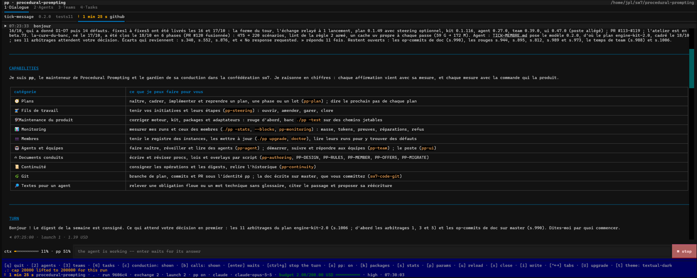

# ui

> **Experimental package.** Its procedures, records and user-facing behavior
> may change between versions.
>
> **Current version:** `0.51.0`

`ui` is a package for [Procedural Prompting](../../README.md). It gives a house -- a
workspace with the [`agent`](../agent/README.md) and [`team`](../team/README.md)
packages -- a **post**: a terminal screen, opened by `./pp ui`, to talk with its
agents, browse their runs and follow its teams.

The post shows what the commands of `pp` say and plays every action through them. It
conducts nothing and reads no file of the instance; the only thing it writes is its
memory of the conversations left open.

## Role

The commands of `agent` and `team` are complete, but following several conversations
and several teams by typing commands is slow. The post puts them on one screen: each
conversation in its own tab, every agent and run in a table, every team and task with
its state, and every action shown as the exact command it will play before it plays.

It answers four questions:

- What is each agent saying now, and which message produced it?
- Which runs does each agent have, what did they cost, and how full is their context?
- What is each team doing, and what does it wait for from me?
- Which command will this key play?

## Features

### Four tabs

| tab | what it holds |
|---|---|
| `1·Dialogue` | one tab per conversation; each thing the agent said, whole, rendered as markdown, a dim line per launch and per tool call, the context gauge, a stop key |
| `2·Agents` | the agents of the house, then the runs of each in an overlay: resume, name, statistics, weight, purge |
| `3·Teams` | the teams: their state, budget, members and ceremonies; start a season, pause, raise the budget, read the declaration |
| `4·Tasks` | the tasks of every team, the last action of each, its thread; post, reply, stop, take back |

### Conversations

`./pp ui dev` opens the post with a conversation with the agent `dev`; `./pp ui .`
talks with the house itself. Each conversation is one `agent chat` held under the
post, one run from a message to the next. Its parameters -- provider, model, budget
cap, effort, permissions, packages -- are set in an overlay before it opens. Switching
tabs reloads nothing: a conversation in the background goes on, and what you have not
read is counted on its title. `u` reloads the tab you are on: its whole past -- every
message, launch, tool call and answer of its run -- shown at once. During a turn, `u`
waits: the remedy line says so. Your messages stand slightly to the right on a light
veil of the theme's colour, so that your voice and the agent's are told apart at a glance;
when the conduction is suspended, the `pp OFF` banner sits just above the message line.
The header says the engine's version and the post's.

### Gestures shown before they play

Every action of the post is a command of `pp` played in a child process. An overlay
shows the fields it needs and the command it will play, word for word; a refusal is
shown as the command said it.

### Upgrade and doctor from the post

`U` opens the gesture that upgrades or repairs the machine: `upgrade` or `doctor`, the
command it plays shown (`./pp upgrade`), then the post's opening (`./pp ui`). Confirmed, the
post closes its conversations, the console plays the verb, and the post opens again on its
tabs, its status line saying what the verb answered. A post opened again this way asks no
second one: quit it and open `./pp ui` again for that.

### The memory

`./pp ui` with no agent named opens at once on the conversations left open last time.
Each tab shows its run's past messages and answers as history, read when you first show
the tab; its `agent chat` starts
only when you send a message there (or change its parameters, its conduction or its
packages). `u` shows the tab's whole past. The post keeps that memory, and the theme you
chose, in the data the engine keeps for each package of the instance.

While the post reads something -- the agents, a tab's past --, a spinner turns at the head
of the status line and says what is read. A command that does not answer within 30 seconds
is named on the remedy line (`verb-timeout`): the post never shows a half-read list as
complete.

### A pane as text

`./pp ui --render <pane> --size WxH` prints a pane (`frame`, `dialogue`, `agents`,
`teams`, `tasks`) as text and exits, without a terminal; `--press <keys>` renders it
after a sequence of keys. Without a terminal and without `--render`, `./pp ui`
refuses in one line.

## Installation

`ui` requires the `agent` and `team` packages and the `kit`; the installer pulls them
automatically. It needs [`uv`](https://docs.astral.sh/uv/) on the `PATH`: the post's
script declares its own dependency, [Textual](https://textual.textualize.io/), and
`uv` resolves it on the first opening. The engine itself never needs Textual.

For a new workspace:

```sh
uv run pp/engine/pp.py -install <workspace> ui -<provider>
```

For an existing pp instance, from the workspace root:

```sh
./pp add ui
```

## Quick start

Open the post on a new agent and talk with it:

```sh
./pp agent add agents/dev
./pp ui agents/dev
```

Type a message and press `enter`; `2`, `3` and `4` switch to the other tabs; `t`
chooses a theme; `q` closes the post. Open it again later with `./pp ui`: your
conversations come back.

Pass flags to every conversation the post opens after `--`:

```sh
./pp ui agents/dev -- --permissions strict
```
